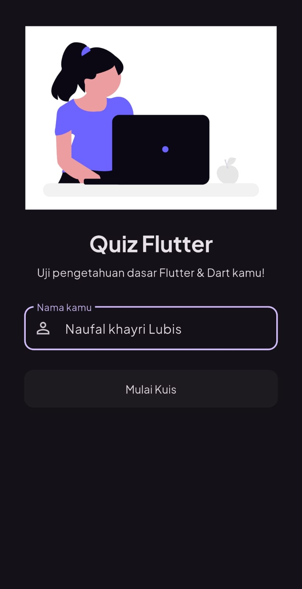
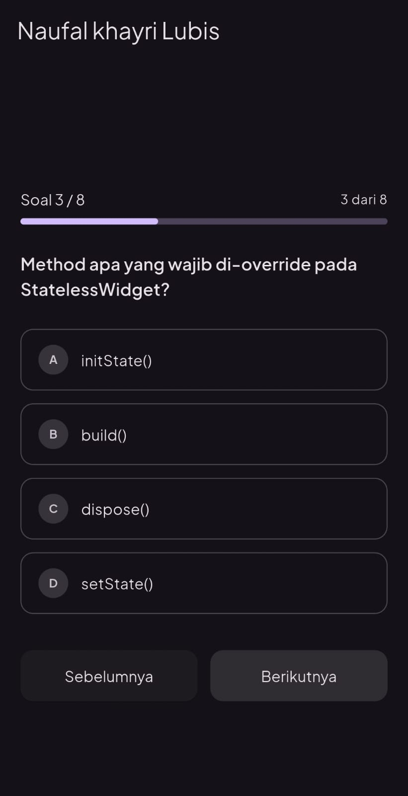
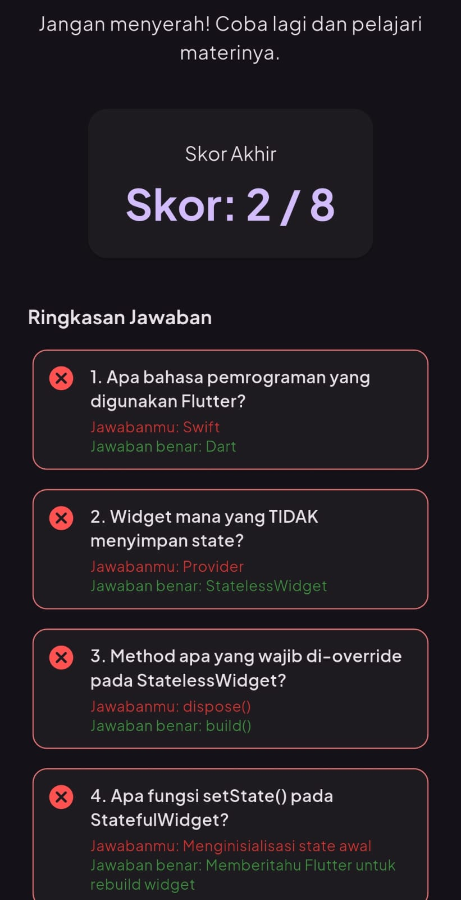

# Quiz Flutter

## Identitas Mahasiswa
- Nama: Naufal Khayri Lubis
- NIM: 241401089
- Lab: Pemrograman Mobile 4

## Informasi Aplikasi
**Nama Aplikasi:** Quiz flutter

**Deskripsi:** Aplikasi kuis pilihan ganda tentang dasar flutter dan dart. user memasukkan nama, jawab 8 soal, lalu lihat skor akhir beserta ringkasan jawaban.

**Fitur:**
- Input nama pengguna dengan validasi
- 8 soal pilihan ganda, bisa maju dan mundur
- Progress bar dan nomor soal
- Jawaban tetap tersimpan saat layar dirotate
- Skor akhir, pesan sesuai skor (semangat jika rendah/selamat jika tinggi), dan ringkasan jawaban   benar/salah
- Tombol ulangi kuis
- Ukuran UI menyesuaikan layar

## Dokumentasi

### Screenshot
| Home | Kuis | Hasil |
|------|------|-------|
|  |  |  |

### Mockup / Prototype
[Link Canva](https://canva.link/b2dzxna7e17yi2c)

### Credit Aset
- Font: Plus Jakarta Sans (Google Fonts) - [link](https://fonts.google.com/specimen/Plus+Jakarta+Sans?preview.script=Latn)
- Ilustrasi: Undraw (unDraw/Freepik/dll) - [link](https://undraw.co/search/study)
-Ikon: Google Ikon  - [link](https://fonts.google.com/icons) 